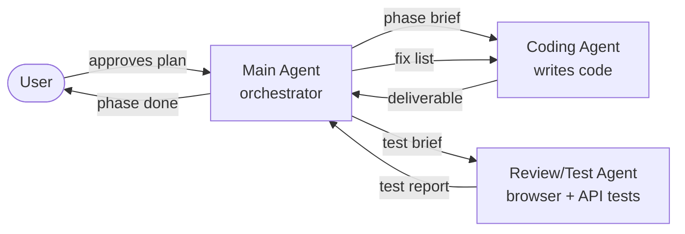

# TaskFlow Demo — Agent Coding Plan

**Version:** 1.0
**Date:** 2026-05-11
**Author:** Planning agent (pre-implementation)
**Source documents:** `docs/original_docs/proposal.md`, `docs/original_docs/SRS.md`, `docs/original_docs/Design_Implementation_Testing.md`
**Goal:** Produce a runnable local web demo of TaskFlow that can be screen-recorded into a 4–5 minute video for the SC6105 course assignment.
**Env**: Use uv to manage dependencies.

---

## 1. Demo Strategy (drives all scope decisions)

The original SRS specifies a 6-module enterprise-grade product (auth, projects, Kanban, AI, notifications, analytics) with PostgreSQL, JWT, WebSocket, SendGrid, Docker, AWS. **For a 4–5 minute demo this is overkill.** The plan deliberately trims to what the camera will capture and removes everything else.

### 1.1 Demo Storyboard (the spec everything else serves)

| # | Scene | Duration | What's on screen |
|---|---|---|---|
| 1 | Landing & sign-in | 0:00–0:25 | Pick a seeded user (Alice / Bob / Carol) from a quick login screen — no real password flow |
| 2 | Project dashboard | 0:25–0:50 | List of 1–2 seeded projects with progress bars; click into "SC6105 Group Project" |
| 3 | Kanban board + DnD | 0:50–1:50 | 4 columns (To Do / In Progress / Review / Done); drag a card between columns; open task detail; edit a field |
| 4 | AI task decomposition | 1:50–3:20 | Type "Build user authentication page", click Decompose, see 4 subtasks streamed in with suggested assignees, accept 3, see them appear on the board |
| 5 | Analytics dashboard | 3:20–4:05 | Burndown line chart, completion-rate bar chart, workload pie chart, big progress % |
| 6 | Notifications | 4:05–4:35 | Switch user to Bob (whom Alice assigned a task), bell icon shows badge "2", open notification panel |
| 7 | Outro | 4:35–5:00 | Brief recap slide / closing |

Anything that does not serve a scene above is **out of scope** for this demo.

### 1.2 Scope Decisions (vs. SRS)

| SRS feature | Demo plan | Reason |
|---|---|---|
| PostgreSQL + Alembic | **SQLite + simple `Base.metadata.create_all`** | Zero-setup; demo runs locally |
| Email registration + password + bcrypt + JWT | **Pick-a-seeded-user dropdown; simple session token in `localStorage`** | Authentic auth eats 1–2 days and is invisible on camera |
| Password reset flow | **Cut entirely** | Not in storyboard |
| SendGrid email | **Cut entirely** | Not in storyboard |
| WebSocket real-time push | **HTTP polling every 5s for the bell icon** | Polling is invisible in a recorded demo and saves a day |
| 24h / 1h deadline cron | **One-shot "fake clock" button on the notification panel for demo purposes (or pre-seeded notifications)** | Cron is not filmable in 5 min |
| Invitations by email link | **Members are pre-seeded into each project** | Not in storyboard |
| Role-based authorization (Owner/Member checks) | **Light: only what's needed to render correct labels; no enforcement tests** | Not in storyboard |
| Docker / Nginx / AWS deploy | **Plain `uvicorn` + `vite dev`; one `start.sh` to launch both** | Local demo only |
| Test coverage ≥70% | **Smoke + E2E happy-path tests for each demo scene** | Demo, not production |
| HTTPS / TLS | **HTTP on localhost** | Local demo |
| AI fallback when LLM down | **Keep — shows resilience; uses a deterministic mock response when no API key is set** | Useful if API is unavailable during recording |

### 1.3 What we keep at full quality (because the camera sees it)

- Kanban board visual quality and drag feel — this is the centerpiece.
- AI decomposition UX — input box, loading state, streamed/animated subtask cards, accept/reject buttons, board update.
- Analytics charts — must look polished; all three chart types must render with real data.
- Notification bell badge animation and dropdown panel.
- Visual design language — distinctive, not generic-AI-aesthetic. Use the `frontend-design` skill.

---

## 2. Technology Stack

Chosen for *minimum setup time* and *maximum demo polish*.

| Layer | Choice | Why |
|---|---|---|
| Backend | **FastAPI** (Python 3.11+) | Matches SRS, async out of the box, OpenAPI docs free |
| DB | **SQLite** via SQLAlchemy 2.x | Zero install, file-based, deletable for a clean demo |
| Frontend build | **Vite + React 18 + TypeScript** | Fastest dev loop |
| UI primitives | **Tailwind CSS + shadcn-style hand-rolled components** (or Ant Design if the team prefers a faster start) | Distinctive look; the `frontend-design` skill prefers Tailwind |
| Drag and drop | **`@dnd-kit/core` + `@dnd-kit/sortable`** | `react-beautiful-dnd` is deprecated; `dnd-kit` is the current standard |
| Charts | **Recharts** | Matches SRS; React-native; covers line/bar/pie |
| HTTP | **Axios** with a thin `apiClient` wrapper | Matches SRS |
| LLM | **DeepSeek API (OpenAI-compatible)** with model `deepseek-v4-flash`; env vars `DEEPSEEK_API_KEY`, `DEEPSEEK_BASE_URL` (default `https://api.deepseek.com`) | Demo-suitable latency and cost; OpenAI-compatible so we use the `openai` Python SDK; free fall-back to a deterministic stub if key is missing |
| Process runner | One `start.sh` running `uvicorn` and `vite` together via `&` and `wait` | Single command for the demo recording |

### 2.1 Repository layout

```
TaskFlow/
├── backend/
│   ├── app/
│   │   ├── main.py              # FastAPI app + CORS + lifespan
│   │   ├── db.py                # SQLAlchemy engine, session, Base.metadata.create_all
│   │   ├── models.py            # User, Project, Membership, Column, Task, Notification, AIRequest, Subtask
│   │   ├── schemas.py           # Pydantic DTOs
│   │   ├── auth.py              # Trivial "X-User-Id" header dependency
│   │   ├── seed.py              # Idempotent seeding of demo users + project
│   │   ├── llm.py               # Anthropic client + mock fallback + prompt builder
│   │   └── routers/
│   │       ├── users.py
│   │       ├── projects.py
│   │       ├── tasks.py
│   │       ├── ai.py
│   │       ├── notifications.py
│   │       └── analytics.py
│   ├── tests/
│   │   ├── test_smoke.py        # API can boot and basic CRUD works
│   │   └── test_ai_mock.py      # AI route returns 3-5 subtasks via mock
│   ├── pyproject.toml           # OR requirements.txt — pick one and commit
│   └── README.md
├── frontend/
│   ├── src/
│   │   ├── main.tsx
│   │   ├── App.tsx              # Router
│   │   ├── api/                 # apiClient + typed endpoint funcs
│   │   ├── pages/
│   │   │   ├── Login.tsx        # Seeded-user picker
│   │   │   ├── Dashboard.tsx
│   │   │   ├── Board.tsx        # Kanban + DnD
│   │   │   ├── Analytics.tsx
│   │   │   └── Settings.tsx     # (Optional, only if there's time)
│   │   ├── components/
│   │   │   ├── Kanban/          # Column, TaskCard, AddTaskInline
│   │   │   ├── AIDecomposePanel.tsx
│   │   │   ├── NotificationBell.tsx
│   │   │   ├── charts/          # Burndown, CompletionBar, WorkloadPie
│   │   │   └── Layout/          # AppShell, TopBar
│   │   ├── contexts/CurrentUser.tsx
│   │   └── styles/index.css
│   ├── index.html
│   ├── vite.config.ts
│   ├── tailwind.config.ts
│   ├── package.json
│   └── README.md
├── start.sh                     # Boots backend + frontend; waits on both
├── docs/
│   ├── coding_plan.md           # This file
│   ├── demo_script.md           # Final beat-by-beat narration written by main agent in Phase 9
│   ├── test_report.md           # Written by review/test agent at the end of each phase
│   └── original_docs/           # Source SRS / proposal / design docs
└── README.md                    # Quickstart: ./start.sh
```

### 2.2 Data model (slim)

Only the tables the demo needs:

- `users` — id, name, email, avatar_color (no password)
- `projects` — id, name, description, deadline, owner_id, created_at
- `memberships` — id, project_id, user_id, role
- `columns` — id, project_id, name, position, status_key
- `tasks` — id, project_id, column_id, title, description, assignee_id, deadline, label, position, created_at, completed_at
- `notifications` — id, user_id, type, message, related_task_id, is_read, created_at
- `ai_requests` — id, project_id, user_id, description, status, created_at
- `subtasks` — id, request_id, title, description, effort, suggested_assignee_id, review_status

Skip: `auth_tokens`, `password_reset_tokens`, `invitations`, `task_history`, `email log`. All cuttable.

### 2.3 Minimum API surface

Group by demo scene; only routes we actually call.

| Method | Path | Used by scene |
|---|---|---|
| `GET /api/users` | List seeded users for the picker | 1 |
| `GET /api/projects` (filtered to current user) | Dashboard list | 2 |
| `GET /api/projects/{id}/board` | Columns + tasks in one shot | 3 |
| `POST /api/projects/{id}/tasks` | Create task | 3 |
| `PATCH /api/tasks/{id}` | Edit fields | 3 |
| `PATCH /api/tasks/{id}/move` | DnD: change column + position | 3 |
| `DELETE /api/tasks/{id}` | (optional) | 3 |
| `POST /api/projects/{id}/ai/decompose` | LLM call returning 3–5 subtasks | 4 |
| `POST /api/ai/results/{id}/accept` | Accept a subtask → create task | 4 |
| `GET /api/projects/{id}/analytics` | Burndown + member stats + workload + progress | 5 |
| `GET /api/notifications?user_id=...` | Bell list | 6 |
| `PATCH /api/notifications/{id}/read` | Click to mark read | 6 |
| `GET /api/notifications/unread-count` | Badge | 6 |

No WebSocket, no `/auth/*`, no `/invitations/*`.

### 2.4 Seed data strategy (load up the DB so the human barely needs to do anything)

**Principle:** the recording person should only have to perform the *single most photogenic action* per scene. Everything else — past activity, member workload, completed tasks, notifications already pending, even the AI input phrasing — must be there before the camera rolls. The seed script is therefore much richer than a typical fixture.

`backend/app/seed.py` is **idempotent** (re-running it yields the same DB) and produces:

**Users (3)** — Alice (Owner, frontend leaning), Bob (backend leaning), Carol (design + QA). Each has a distinct avatar color and a one-line "skills" string used by the AI prompt.

**Projects (1, possibly 2)** — Primary: "SC6105 Group Project" with deadline 2 weeks out, owner = Alice, members = all three. (Optional second project "Side Hackathon" so the dashboard shows >1 card; cut if time is tight.)

**Columns (4)** — To Do, In Progress, Review, Done. Status keys `todo / doing / review / done`.

**Tasks (12, hand-authored)** — distributed across columns so analytics has a real story:

| Column | Count | Notes |
|---|---|---|
| To Do | 4 | Mix of assignees; one assigned to Bob (so Scene 6 has a "you were assigned" notification) |
| In Progress | 3 | At least one assigned to Alice, one to Bob |
| Review | 2 | One assigned to Bob (the one Alice "moved to Review" → notification source) |
| Done | 3 | All have `completed_at` set on different days over the past week so the burndown chart has a real downward slope |

Tasks have realistic titles (e.g., "Draft project proposal", "Implement login API", "Design Kanban mockup", "Write API spec", "Set up CI", "Build burndown chart component"…), so the look reads as a real student team.

**Notifications (3 for Bob, all pre-seeded as unread)** — created by seed.py so Scene 6 lights up the bell *immediately* without anything happening live:
1. `TASK_ASSIGNED` — "Alice assigned you a task: Implement login API" (1 hour ago)
2. `STATUS_CHANGED` — "Task moved to Review: Write API spec" (30 min ago)
3. `TASK_ASSIGNED` — "Alice assigned you a task: Set up CI" (10 min ago)

(Alice and Carol get 0 unread, so the bell looks clean when Alice is logged in.)

**AI history** — empty. The AI scene must be live to feel real.

**What stays "live" (must happen on camera):**
- Scene 3: one drag-and-drop. The dragged task is still in its starting column on disk.
- Scene 4: one `POST /ai/decompose` call to DeepSeek (or mock).
- Scene 4: 2–3 `POST /accept` clicks creating real new tasks.
- Scene 6: one click "mark as read" on a notification.

**What recording person does NOT do:**
- ❌ Type in any task editor — all displayed tasks are pre-seeded.
- ❌ Create a task from scratch — the inline composer can stay implemented but is not used in the take.
- ❌ Write the AI input from scratch — the textarea pre-fills with a default placeholder/example phrase the user just clicks past, OR the recorder pastes from clipboard.
- ❌ Send an invitation, change settings, edit a profile.

**Reset script** — `scripts/reset.sh`:
```bash
#!/usr/bin/env bash
rm -f backend/taskflow.db
cd backend && uv run python -m app.seed
```

This is the first thing the recorder runs before each take.

---

## 3. Agent Architecture

The work is divided across three agents that run in sequence-with-loops, not in parallel. **The main agent never writes production code itself**; it briefs sub-agents and reviews their output.



### 3.1 Main Agent (orchestrator)

**Role:** Reads the plan, owns phase order, briefs sub-agents, decides when a phase is done, escalates to user only on genuine ambiguity (e.g., "Anthropic API key missing — use mock or stop?"). Never writes feature code; may write small glue (start.sh, README quickstart) and the final demo script.

**Tools:** Read, Edit, Write, Bash, Agent, AskUserQuestion (sparingly).

**Inputs each phase:**
- This `coding_plan.md`
- Previous test report
- Current repo state

**Outputs each phase:**
- A self-contained brief to the coding agent: goal, files to touch, acceptance criteria, what's already done, what's out of scope.
- After coder reports done: a brief to the reviewer with the same scope and explicit pass/fail criteria.
- A short status note appended to `docs/test_report.md` (one paragraph per phase: what shipped, what's still flaky, decisions made).

**Stopping rules:**
- A phase is "done" when the reviewer reports all acceptance criteria pass.
- After 2 failed coder→reviewer round-trips on the same phase, escalate to user with a specific question.

### 3.2 Coding Agent

**Role:** Implements one phase at a time per the main agent's brief. Picks libraries already approved in §2; does not introduce new dependencies without escalating. Writes code, runs the build, fixes its own type/lint errors before reporting done.

**Tools:** Read, Edit, Write, Bash, plus the `frontend-design:frontend-design` skill for visual phases. May also use Grep / Glob via Bash.

**Constraints:**
- Use `deepseek-v4-flash` as the default model via DeepSeek's OpenAI-compatible endpoint (cheap, fast).
- All env-dependent code reads from `.env` via `python-dotenv` (backend) or `import.meta.env` (Vite).
- Idempotent seed: re-running `seed.py` must not duplicate rows.
- Optimistic UI on drag: update the board immediately, roll back on PATCH failure.
- No comments unless the WHY is non-obvious.

**Self-checks before reporting done:**
1. `cd backend && pytest -x` passes.
2. `cd frontend && npm run typecheck && npm run build` passes.
3. `./start.sh` boots and the homepage loads (curl + grep for a known string).

### 3.3 Review/Test Agent

**Role:** Verifies a phase end-to-end against the demo storyboard. Runs API smoke tests and **drives a real browser via the `chrome-devtools-mcp` skill** to confirm each scene visually works. Produces a structured test report with pass/fail per acceptance criterion.

**Tools:** Read, Bash, the `chrome-devtools-mcp:chrome-devtools` skill, plus all `mcp__plugin_chrome-devtools-mcp_chrome-devtools__*` browser tools (click, navigate_page, take_snapshot, take_screenshot, list_console_messages, evaluate_script, etc.).

**Outputs (one per phase, appended to `docs/test_report.md`):**

```
## Phase N — <name> — <date> — <PASS/FAIL>

### Acceptance criteria
- [x] / [ ] item 1
- [x] / [ ] item 2

### Browser checks
- Login picker renders 3 users — PASS
- Dragging "T-3" from To Do to In Progress persists after reload — PASS
- ...

### Bugs found (for coding agent)
1. [P0] Task card overflows on long titles (component: Kanban/TaskCard.tsx)
2. [P1] Burndown line uses wrong color on dark mode

### Console errors
(paste relevant browser console output)

### Recommendations
- ...
```

**Bug priority:**
- **P0** — blocks the demo storyboard.
- **P1** — visible glitch on camera but not blocking.
- **P2** — nice to have, deferrable.

The main agent only sends P0 and P1 fixes back to the coder.

---

## 4. Phase Plan

Each phase has: **Goal**, **Coding agent brief**, **Review/test brief**, **Acceptance criteria**, **Estimated effort** (LLM-agent time, not human).

### Phase 0 — Bootstrap (≈ 30 min)

- **Goal:** Repo skeleton, `start.sh`, root `README.md` quickstart, `.gitignore` updates, `.env.example` for both halves. No app logic.
- **Coder:** Create `backend/` and `frontend/` directories with the structure in §2.1, plus empty placeholder files. Init `package.json` (Vite + React + TS template). Backend deps managed by **uv**: run `uv init` in `backend/`, then `uv add fastapi sqlalchemy uvicorn python-dotenv openai pytest httpx`. (We use the `openai` SDK because DeepSeek's API is OpenAI-compatible.) Write `start.sh` that runs `uv run uvicorn app.main:app --reload` and `npm run dev` together and traps SIGINT.
- **Reviewer:** `./start.sh` starts both servers; `curl localhost:8000/health` returns `{"ok":true}`; `curl localhost:5173` returns HTML containing the app title.

### Phase 1 — Backend foundation + seed data (≈ 1 hr)

- **Goal:** SQLAlchemy models, `db.py`, idempotent `seed.py`, `users.py` and `projects.py` routers wired up. CORS allows `localhost:5173`.
- **Coder brief:** Implement the data model in §2.2. Implement the **full seed strategy in §2.4** — 3 users, 1 project, 4 columns, **12 hand-authored tasks distributed per the §2.4 table**, **3 pre-seeded unread notifications targeting Bob**, and `completed_at` timestamps spread across the past week on Done-column tasks so the burndown chart has a real slope. Implement `X-User-Id` header dependency that returns the current `User`.
- **Reviewer:** `pytest backend/tests/test_smoke.py` passes; `GET /api/users` returns 3 users; `GET /api/projects` returns 1 project for Alice; `GET /api/projects/1/board` returns 4 columns with 12 tasks total; `GET /api/notifications/unread-count` with `X-User-Id: <bob>` returns 3.
- **Acceptance:** smoke tests green; `seed.py` re-run does not duplicate.

### Phase 2 — Frontend shell + login picker + dashboard (≈ 1.5 hr)

- **Goal:** App boots, you can pick a user, you land on a dashboard listing your projects, clicking one navigates to `/board/:id` (which can be a placeholder for now).
- **Coder brief:** React Router with routes `/login`, `/`, `/board/:id`, `/analytics/:id`. `CurrentUser` context persisted to `localStorage`. `apiClient` axios instance that injects `X-User-Id`. `Login.tsx` shows three large user cards (use `frontend-design` skill for distinctive look). `Dashboard.tsx` shows project cards with name, deadline, progress bar (compute client-side or a temporary 50%).
- **Reviewer:** Browser test via `chrome-devtools-mcp` — load `/login`, click "Alice", verify redirect to `/`, verify project card appears, click project, verify URL change to `/board/1`. Take a screenshot of the dashboard.
- **Acceptance:** all three users selectable; refreshing the page keeps you logged in.

### Phase 3 — Kanban board + drag-and-drop (≈ 2.5 hr) ★ centerpiece

- **Goal:** Scene 3 of the storyboard works perfectly.
- **Coder brief:**
  - Implement `tasks.py` router with create / patch / move / delete.
  - `Board.tsx` fetches `/api/projects/{id}/board`, renders 4 columns, each with sortable task cards via `@dnd-kit`.
  - Card shows title, assignee avatar (colored circle with initial), label pill, deadline ("in 2 days" via a small relative-time helper).
  - "Add task" inline at bottom of each column (Enter to save, Escape to cancel).
  - Click card → modal with editable title / description / assignee / deadline / label.
  - Optimistic UI on drag; PATCH `/move` with `{column_id, position}`; rollback + toast on failure.
  - Use `frontend-design` skill to make the board feel polished, not generic — distinct column header styles, tasteful card shadows, smooth drag animation.
- **Reviewer:**
  - Browser test: drag a task between columns, refresh page, verify persistence.
  - Click card, edit title, save, verify update both in modal and on board.
  - Add a new task via inline composer.
  - Check console — zero errors.
  - Performance: drag-to-drop visual feedback under 500 ms (manually estimated by frame count in screenshot pair).
- **Acceptance:** drag persists across reload; edit persists; no console errors; visually polished.

### Phase 4 — AI Task Decomposition (≈ 2 hr) ★ wow factor

- **Goal:** Scene 4 works. Real LLM call when `DEEPSEEK_API_KEY` is set; deterministic mock when not.
- **Coder brief:**
  - `backend/app/llm.py`: function `decompose(description, members) -> list[Subtask]`. Use the **OpenAI Python SDK pointed at DeepSeek** (DeepSeek is OpenAI-compatible):
    ```python
    from openai import OpenAI
    client = OpenAI(
        api_key=os.getenv("DEEPSEEK_API_KEY"),
        base_url=os.getenv("DEEPSEEK_BASE_URL", "https://api.deepseek.com"),
    )
    resp = client.chat.completions.create(
        model="deepseek-v4-flash",
        messages=[{"role": "system", "content": SYSTEM_PROMPT},
                  {"role": "user", "content": user_prompt}],
        response_format={"type": "json_object"},
        temperature=0.3,
    )
    ```
    Build a prompt that includes member names + skills + current task counts and asks for JSON `{subtasks: [{title, description, effort, suggested_assignee_name}]}` with 3–5 items. Parse JSON; on parse failure, missing API key, or HTTP error, return a deterministic 4-item mock derived from the input string. Map `suggested_assignee_name` back to a `user_id` by case-insensitive name match.
  - `POST /api/projects/{id}/ai/decompose` calls `llm.decompose`, persists `AIRequest` + `Subtask` rows, returns them.
  - `POST /api/ai/results/{id}/accept` with `{subtask_id, modifications?}` creates a `Task` in the To Do column and marks the subtask accepted.
  - Frontend `AIDecomposePanel.tsx` slides in from the right; textarea + "Decompose" button; loading state with shimmer; on result, render subtask cards with Accept / Reject buttons; accepted ones get a green check and animate out; rejected ones fade.
- **Reviewer:**
  - With `DEEPSEEK_API_KEY` absent (rename env var temporarily): submit, verify 4 mock subtasks render.
  - With `DEEPSEEK_API_KEY` present: submit "Build a complete user authentication page with email login and password reset", verify response within 15 s (NF-003 is 10 s but we allow slack), verify 3–5 subtasks.
  - Accept 2 subtasks; verify 2 new cards appear in To Do.
- **Acceptance:** both modes (real / mock) work; no API key crashes the app.

### Phase 5 — Analytics dashboard (≈ 1.5 hr)

- **Goal:** Scene 5. Three charts + progress %.
- **Coder brief:**
  - `analytics.py`: one endpoint returning `{burndown: [...], member_stats: [...], workload: [...], progress: {total, completed, percent}}`. Burndown synthesized from `created_at` and `completed_at` (compute remaining at each day from project start to now).
  - `Analytics.tsx` route at `/analytics/:id`. Top: big progress ring + percent. Then three Recharts components in a responsive grid: `LineChart` (burndown), `BarChart` (completion by member), `PieChart` (workload).
  - Use `frontend-design` skill to make the charts feel intentional — pick a coherent palette of 4–5 colors used across all three charts, label axes properly, avoid default Recharts gray.
- **Reviewer:** Browser test: navigate to analytics, take screenshot, verify all three charts have data, verify progress ring matches 6/N tasks done from seed (you may need to mark some seeded tasks as done in seed.py — coordinate with Phase 1).
- **Acceptance:** all three charts render with data; no overlap; mobile-tablet breakpoint reasonable (1024×768).

### Phase 6 — Notifications (≈ 1 hr)

- **Goal:** Scene 6. Bell icon with unread badge, dropdown panel.
- **Coder brief:**
  - Create a notification when:
    - A task is created with an assignee (TASK_ASSIGNED, target = assignee).
    - A task is moved to a different column (STATUS_CHANGED, target = assignee).
    - A subtask is accepted from AI panel (TASK_ASSIGNED, target = suggested assignee).
  - `GET /api/notifications` returns user's notifications newest first; `unread-count` returns int.
  - `NotificationBell.tsx` polls `/unread-count` every 5 s; clicking opens a dropdown listing items with read/unread state and a "Mark all read" button.
  - The 3 unread notifications for Bob are **already seeded in Phase 1** (see §2.4); this phase only needs to render them and wire up read/unread toggling. Notifications created by live actions (drag in Scene 3, AI accept in Scene 4) are bonus and may surface to whoever is logged in.
- **Reviewer:** Browser test: log in as Bob, verify badge "3", open panel, verify items render with relative timestamps, click an item → marks read, badge decreases to 2.
- **Acceptance:** seeded badge shows on first Bob login; click to mark read works.

### Phase 7 — Polish & visual coherence (≈ 1 hr)

- **Goal:** The whole app feels like it was designed by one person, not stitched together.
- **Coder brief:** Run `frontend-design` skill in critique mode across `Login`, `Dashboard`, `Board`, `Analytics`. Unify spacing, colors, typography, transition timings. Add a subtle app-shell with logo + current-user chip + bell + nav. Loading skeletons everywhere we have a fetch. Empty states for "no projects" and "no notifications".
- **Reviewer:** Take screenshots of each page; compare against the storyboard; flag any jarring differences.
- **Acceptance:** subjective — main agent reviews screenshots and signs off.

### Phase 8 — End-to-end test pass (≈ 45 min)

- **Goal:** A full storyboard rehearsal with no bugs.
- **Coder:** *No work unless reviewer finds bugs.*
- **Reviewer:** Run the entire 7-scene storyboard in Chrome via `chrome-devtools-mcp`. For each scene:
  1. Take a screenshot at the moment the camera would land.
  2. List console errors.
  3. Confirm the action specified in §1.1 is reachable in ≤ 2 clicks from the previous scene.
- **Acceptance:** zero P0 bugs across all 7 scenes.

### Phase 9 — Demo script + README quickstart (≈ 30 min)

- **Goal:** Hand-off package for screen recording.
- **Main agent (writes directly):**
  - `docs/demo_flow.md` (already drafted; main agent verifies it still matches the implementation and updates if needed). The "before you record" checklist must include: reset DB (`rm backend/taskflow.db && uv run python -m app.seed`), set window to 1440×900, open at `/login`.
  - `README.md` (root) — 6-line quickstart: `cp backend/.env.example backend/.env`, set `DEEPSEEK_API_KEY` (optional), `cd backend && uv sync`, `cd frontend && npm install`, `./start.sh`, open `http://localhost:5173`.
- **Reviewer:** Follow the README from a fresh clone in a tmp dir; confirm app boots within 2 minutes from `git clone`.
- **Acceptance:** README quickstart works; demo script lines up with what the app actually does.

---

## 5. Cross-Cutting Standards

### 5.1 Coding standards

- **Python:** PEP 8, type hints on public functions, no comments unless WHY is non-obvious.
- **TypeScript:** strict mode on; no `any` in checked-in code; functional components only.
- **No premature abstractions:** don't add a Repository pattern layer — just use SQLAlchemy sessions directly in routers via Depends. The SRS prescribes a Repository pattern; we deliberately drop it because the demo doesn't justify the indirection.
- **Error handling at boundaries only:** validate inputs at API edges via Pydantic; trust internal calls. The `try/except` for the LLM call is a real boundary; no defensive `try` around DB inserts.
- **Optimistic UI everywhere.** No spinners on actions the user understands as instant (drag, click, type).

### 5.2 Visual design

- Use the `frontend-design:frontend-design` skill in Phase 2 (initial look), Phase 3 (Kanban polish), and Phase 7 (final unification).
- Avoid the "generic AI dashboard" aesthetic: blue gradient backgrounds, default fonts, default Recharts gray. Pick a small palette and use it consistently.
- Type scale: 14 px body, 13 px secondary, 18 px section headers, 24 px page titles. Inter or Geist.
- Spacing scale: 4 / 8 / 12 / 16 / 24 / 32 px only.

### 5.3 Browser-test conventions (review/test agent)

- Use `chrome-devtools-mcp` skill at the start of every browser session.
- Take a screenshot at the *opening frame* of each scene; save under `docs/screenshots/phase-N-scene-X.png`.
- Always check `list_console_messages` before declaring a scene PASS — any error or red warning is a P1 minimum.
- Use `evaluate_script` to confirm DOM state when visual inspection is ambiguous (e.g., `document.querySelectorAll('[data-task-card]').length === 6`).

### 5.4 Demo robustness

- The demo must run **with no internet** if `DEEPSEEK_API_KEY` is unset (mock LLM kicks in). This is the recording fallback.
- Reset script `scripts/reset.sh` deletes `backend/taskflow.db` and re-seeds. Document in `demo_script.md`.

---

## 6. Risks & Contingencies

| Risk | Likelihood | Impact | Contingency |
|---|---|---|---|
| LLM API latency spikes during recording | Medium | Botched scene 4 | Pre-record scene 4 with API; in worst case, switch to mock fallback (deterministic ~50 ms) |
| `@dnd-kit` integration takes longer than 2.5 h | Medium | Phase 3 slips | Fall back to a "click destination column" interaction — preserves the demonstrate-status-change story without DnD physics |
| Recharts looks generic | Low | Phase 5 weak on camera | Spend extra polish time in Phase 7 unifying chart styles; consider a thin custom tooltip component |
| Tailwind setup conflicts with Vite version | Low | Phase 0 slips | Pre-validated combo: Vite 5 + Tailwind 3.4 + React 18.3 — call out in coder brief |
| DEEPSEEK_API_KEY missing in user's env at recording time | Medium | Mock used | Acceptable; mock is deterministic and visually similar; mention in demo as "running offline mode" or hide |
| Notification polling looks stuttery in 5 s | Low | Scene 6 weak | Reduce poll to 2 s only on the bell page |

---

## 7. Out of Scope (explicit)

To prevent scope creep, the following SRS items are **not** to be implemented unless main agent escalates to user:

- Real registration, email verification, password reset, account locking
- JWT generation and validation; bcrypt hashing
- WebSocket server, queueing for disconnected users
- SendGrid email delivery (any email at all)
- Background scheduler for deadline reminders
- Project invitations and accept-link flow
- Role-based authorization enforcement (Owner-only operations)
- Project settings page, ownership transfer, delete-with-typed-confirmation
- Filter / search UI on the Kanban board (REQ-FR-017, 018)
- Customizable column names (REQ-FR-019)
- Task labels editor UI (labels exist in data model but only one is shown per card)
- Task comments, activity log, attachments
- File uploads of any kind
- Performance / load testing (Locust, 50 concurrent users)
- Security testing (SQL injection, XSS) beyond Pydantic's natural defenses
- Docker, Nginx, AWS deployment artifacts
- CI / GitHub Actions
- Coverage tooling and 70% target — we ship a small smoke + happy-path suite only

If during the demo the user asks for any of these, the main agent should ask whether to extend scope and update this plan.

---

## 8. Total Estimated Effort

Sum of phase estimates: ~12 hours of agent time. With round-trips (coder ↔ reviewer ↔ main) realistically **15–18 hours**. Plan delivers a recording-ready demo in roughly two working days for an automated agent run.

---

## 9. Hand-off Checklist (main agent uses this to declare "done")

- [ ] All 9 phases marked PASS in `docs/test_report.md`.
- [ ] Storyboard scenes 1–7 reproducible from a fresh `git clone` in ≤ 2 min.
- [ ] `./start.sh` boots both servers cleanly with no console errors on the homepage.
- [ ] Mock LLM path works with `DEEPSEEK_API_KEY` unset.
- [ ] Real LLM path works with valid key.
- [ ] `docs/demo_script.md` exists and matches actual app behavior.
- [ ] `README.md` quickstart verified by reviewer on a clean checkout.
- [ ] DB reset script (`scripts/reset.sh`) verified.
