# TaskFlow — Software Requirements Specification

**An AI-Powered Project Management Platform for Student Teams**
Version 1.0 | Group 2 | SC6105 Software Engineering, NTU | April 2026

---

## 1. Introduction

### 1.1 Purpose
This SRS describes functional and non-functional requirements for TaskFlow, an AI-powered web-based project management platform for NTU student teams. It serves as the basis for design, implementation, and testing.

TaskFlow addresses fragmented communication, manual progress tracking, uneven workload distribution, and missed deadlines in student team projects.

### 1.2 Document Conventions
- Requirements ID format: `REQ-XX-NNN` (e.g., `REQ-FR-001`, `REQ-NF-001`)
- `shall` = mandatory requirement; `must` = constraint/performance requirement
- Priority: High / Medium / Low
- Diagrams follow UML 2.0 notation

### 1.3 Intended Audience

| Audience | Suggested Sections |
|---|---|
| Instructor / Advisor | All |
| Development Team | §2, §3, §4, §5, Appendix A |
| UI/UX Designers | §3.1, §4 |
| QA / Testers | §4, §5 |

### 1.4 Product Scope
Core capabilities:
- Kanban-style task board with drag-and-drop
- AI-powered task decomposition (high-level → 3-5 subtasks)
- Notification system: email (SendGrid) + in-app (WebSocket)
- Data analytics: burndown chart, completion rate, workload distribution
- User authentication with role-based project access

Scoped for NTU teams of 4–6 members on semester-long projects. Not intended for enterprise use.

### 1.5 References
- IEEE Std 830-1998 SRS Recommended Practice
- SC6105 Course Project Requirements, NTU, 2026
- TaskFlow Project Proposal, Team Agile Five, March 2026
- The Scrum Guide, Scrum.org, 2020

---

## 2. Overall Description

### 2.1 Product Perspective
TaskFlow fills the gap between overly complex enterprise tools (Jira, Asana) and overly simple consumer tools (Trello). It uses a three-tier client-server architecture:

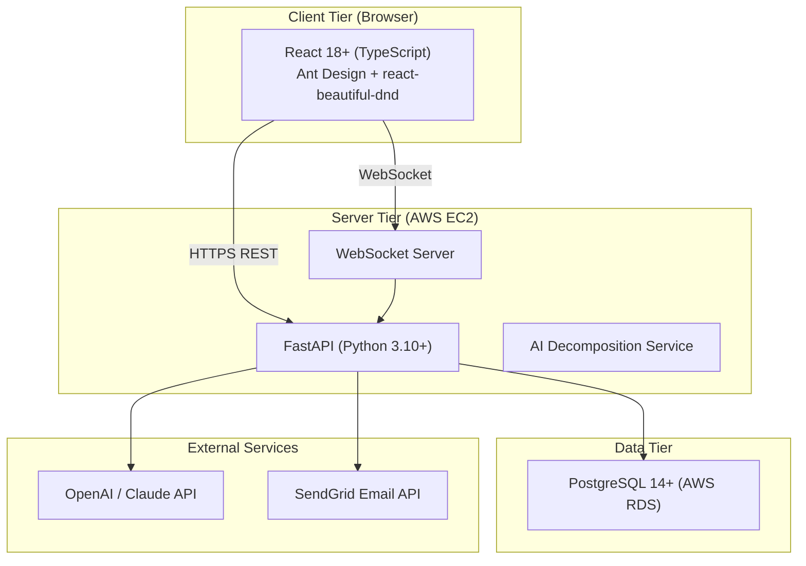

### 2.2 Product Functions

| Module | Description |
|---|---|
| User Authentication | Email-based registration/login; JWT auth; password reset via email |
| Project Management | Create/edit/delete projects; invite members via email; role-based access (Owner, Member) |
| Kanban Board | Multi-column board with drag-and-drop; task cards with title, description, labels, deadline, assignee; filter and search |
| AI Assistant | Accepts high-level description → generates 3–5 subtasks with effort estimates and assignment suggestions via LLM API |
| Notification System | Email (SendGrid) + in-app (WebSocket); triggers: deadline reminders, task assignment, status changes |
| Data Analytics | Burndown chart; completion rate by member; workload distribution pie chart; project progress % |

### 2.3 User Classes

| User Class | Description | Frequency | Expertise |
|---|---|---|---|
| Project Owner | Creates project; full admin privileges | Daily | Basic–Intermediate |
| Team Member | Creates/edits/moves tasks; views analytics | Daily | Basic |
| System Administrator | Manages accounts and system config | Weekly | Advanced |

### 2.4 Operating Environment
- **Client:** Chrome 90+, Firefox 88+, Safari 14+, Edge 90+ (desktop & tablet)
- **Server:** Linux (AWS EC2), Python 3.10+
- **Database:** PostgreSQL 14+ on AWS RDS
- **Network:** HTTPS (TLS 1.2+)

### 2.5 Design & Implementation Constraints
- Frontend: React 18+ (TypeScript); Backend: Python FastAPI
- AI module: external LLM API (OpenAI or Claude), no local GPU
- Email: SendGrid free tier (100 emails/day)
- Timeline: 12 weeks, team of 5
- VCS: Git on GitHub

### 2.6 Assumptions & Dependencies
**Assumptions:** Users have stable internet, valid email addresses, and the LLM API interface remains stable.

**Dependencies:** External LLM API, SendGrid, AWS infrastructure, open-source libs (React, Ant Design, react-beautiful-dnd, FastAPI, SQLAlchemy, Recharts).

---

## 3. External Interface Requirements

### 3.1 User Interfaces
Responsive SPA built with React and Ant Design. Primary views:

- **Login / Registration:** Email + password inputs, registration form, password reset link
- **Dashboard / Project List:** All user projects with name, progress %, upcoming deadlines; "Create Project" button
- **Kanban Board:** Columns (To Do, In Progress, Review, Done) with draggable task cards showing title, assignee avatar, label, deadline; "Add Task" and "AI Decompose" buttons
- **Task Detail Modal:** Full task info: title, description, assignee, labels, deadline, subtasks, comments, activity log
- **AI Decomposition Panel:** Side panel to input high-level description; shows AI-generated subtasks with effort + suggested assignees
- **Analytics Dashboard:** Burndown chart, completion rate bar chart, workload pie chart, overall progress %
- **Notification Center:** In-app panel showing task assignment alerts, deadline reminders, status changes

### 3.2 Hardware Interfaces
Web-based; no specialized hardware. Requires standard network + AWS cloud hardware.

### 3.3 Software Interfaces

| Interface | Description |
|---|---|
| OpenAI / Claude API | REST API for task decomposition. Input: task description text. Output: JSON with subtasks, effort estimates, assignee suggestions |
| SendGrid API | REST API for transactional email (deadline reminders, assignments, password reset) |
| PostgreSQL | Relational DB via SQLAlchemy ORM — stores users, projects, tasks, notifications, analytics |
| GitHub API (optional) | Link commits to tasks |

### 3.4 Communications Interfaces
- All client-server: HTTPS (TLS 1.2+) port 443
- Real-time notifications: WebSocket
- Email: SendGrid SMTP/API over TLS
- AI service: HTTPS REST to LLM provider

---

## 4. System Features

### 4.1 Use Case Model

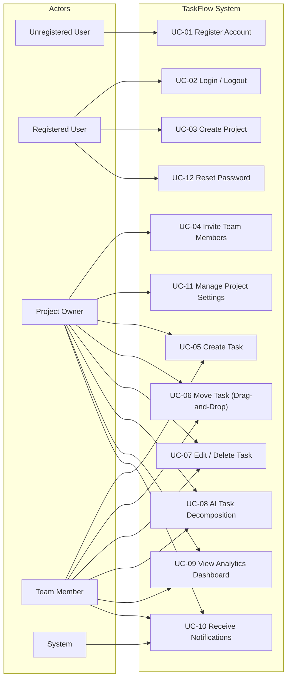

#### 4.1.1 Use Case Descriptions

**UC-01: Register Account**
- Actor: Unregistered User
- Pre: Valid email, not already registered
- Post: Account created, redirected to login
- Flow: Navigate to register → Enter name/email/password → Validate → Create account + confirmation email → Redirect to login
- Alt: 3a. Email exists → error; 3b. Weak password → feedback

**UC-02: Login / Logout**
- Actor: Registered User
- Pre: Registered account
- Post: Login: JWT issued, redirect to Dashboard | Logout: session terminated
- Flow: Enter email/password → Validate → Issue JWT → Redirect to Dashboard; Logout: invalidate token + redirect
- Alt: 3a. Invalid credentials → error; 3b. 5 failed attempts → lock 15 min

**UC-03: Create Project**
- Actor: Registered User → becomes Owner
- Pre: Logged in
- Post: Project created with default Kanban columns
- Flow: Click "Create Project" → Enter name/description/deadline → System creates project with default columns → Redirect to Kanban
- Alt: 2a. Empty name → prompt

**UC-04: Invite Team Members**
- Actor: Project Owner
- Pre: Logged in, Owner of project
- Post: Invitation emails sent; accepted invitees added as Members
- Flow: Enter email addresses → Generate unique invite links → Send via SendGrid → Invitee clicks → Added as Member
- Alt: 2a. Email already a member → notify; 5a. No account → redirect to register

**UC-05: Create Task**
- Actor: Owner / Member
- Pre: Logged in with project access
- Post: Task card appears in selected column
- Flow: Click "Add Task" in column → Enter title/description/assignee/labels/deadline → Validate + create → Card appears → Notify assignee
- Alt: 2a. Optional fields can be blank; 3a. Past deadline → warning

**UC-06: Move Task (Drag-and-Drop)**
- Actor: Owner / Member
- Pre: On Kanban board with at least one task
- Post: Task moved, status updated
- Flow: Click & hold card → Drag to new column → Update status → Notify assignee of status change
- Alt: 2a. Drop back to original → no change

**UC-07: Edit / Delete Task**
- Actor: Owner / Member
- Pre: Logged in, task exists
- Post: Edit: task updated | Delete: task removed
- Flow: Click task card → Modify fields → Save → Validate + update | Delete: click Delete → confirm → remove from board + DB
- Alt: 4a. Empty required fields → highlight; 7a. Cancel → unchanged

**UC-08: AI Task Decomposition**
- Actor: Owner / Member
- Pre: Logged in, project access, ≥1 team member
- Post: 3–5 subtasks generated, optionally added to Kanban
- Flow: Click "AI Decompose" → Enter high-level description → Send to LLM API with team profiles → LLM returns 3–5 subtasks → Display for review → User accepts/modifies/rejects → Accepted subtasks added to board
- Alt: 4a. LLM unavailable → error + suggest manual; 6a. User may edit before accepting

**UC-09: View Analytics Dashboard**
- Actor: Owner / Member
- Pre: Logged in, ≥1 task in project
- Post: Dashboard displayed with current data
- Flow: Navigate to Analytics → Retrieve + calculate metrics → Display charts
- Alt: 2a. No tasks → prompt to create tasks

**UC-10: Receive Notifications**
- Actor: Owner / Member
- Pre: Logged in; trigger event occurred
- Post: In-app and/or email notification received
- Flow: Trigger event → Create notification record → Send email (SendGrid) → Push in-app via WebSocket → User sees badge → Mark as read
- Alt: 3a. SendGrid unavailable → retry ×3 then log failure; 4a. WebSocket lost → queue + deliver on reconnect

**UC-11: Manage Project Settings**
- Actor: Project Owner
- Pre: Logged in, Owner of project
- Post: Settings updated
- Flow: Navigate to Settings → Edit name/description/deadline | Customize column names | Remove members | Transfer ownership | Delete project (with name-confirmation)
- Alt: 5a. After transfer, previous Owner becomes Member

**UC-12: Reset Password**
- Actor: Registered User
- Pre: Registered account, forgot password
- Post: Password updated
- Flow: Click "Forgot password?" → Enter email → System sends reset link (valid 1h) → User clicks link → Enter + confirm new password → Validate + update → Redirect to login
- Alt: 2a. Email not registered → generic success (prevent enumeration); 4a. Expired token → error + request new link

---

### 4.2 User Authentication

**Priority:** High

#### Functional Requirements

| Req ID | Description | Priority |
|---|---|---|
| REQ-FR-001 | System shall allow registration with valid email and password | High |
| REQ-FR-002 | Password must contain ≥8 chars, 1 uppercase, 1 number, 1 special char | High |
| REQ-FR-003 | Authenticate users via JWT tokens (default expiry: 24h) | High |
| REQ-FR-004 | Provide password reset via email verification link | Medium |
| REQ-FR-005 | Logout by invalidating current JWT token | High |

#### Conceptual Class Diagram

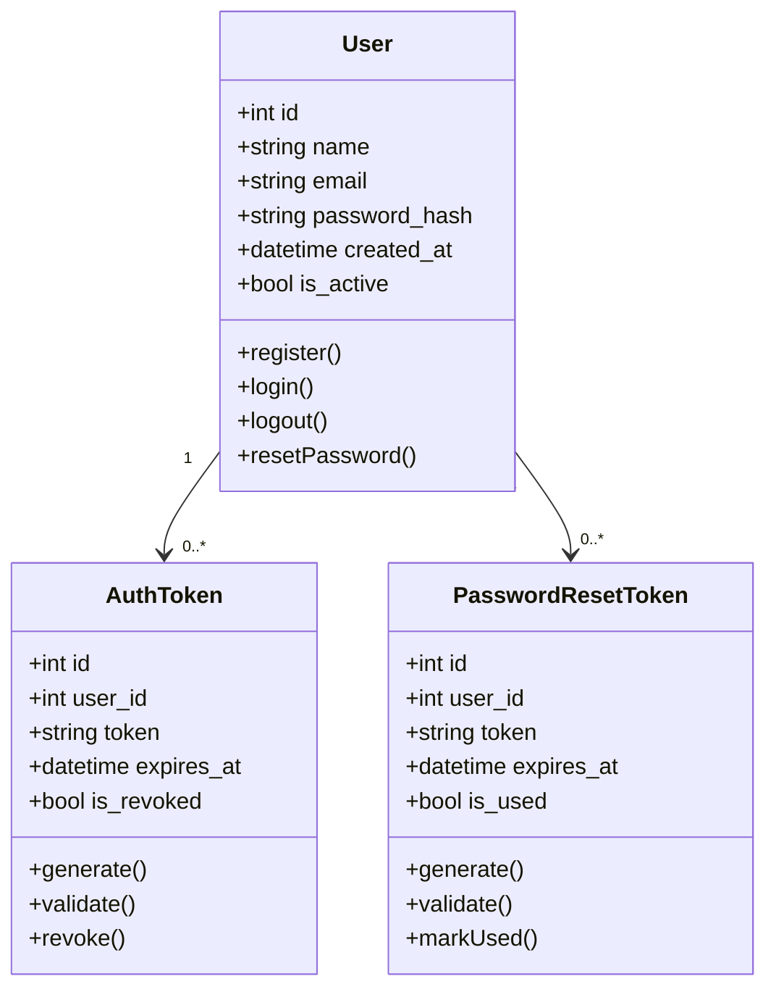

#### Sequence Diagram — User Login

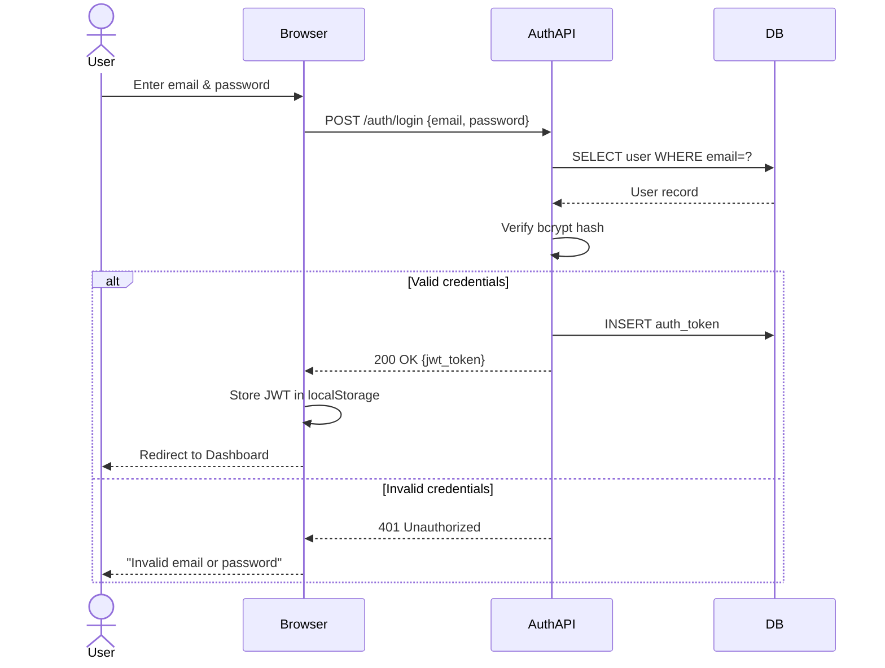

---

### 4.3 Project Management

**Priority:** High

#### Functional Requirements

| Req ID | Description | Priority |
|---|---|---|
| REQ-FR-006 | Allow logged-in user to create project in ≤3 steps | High |
| REQ-FR-007 | Assign project creator as Owner with full admin privileges | High |
| REQ-FR-008 | Allow Owner to invite members by email address | High |
| REQ-FR-009 | Send invitation email with unique join link (via SendGrid) | High |
| REQ-FR-010 | Support two roles: Owner (full access), Member (task management) | Medium |
| REQ-FR-011 | Allow Owner to edit project name, description, deadline | Medium |
| REQ-FR-012 | Allow Owner to remove members from the project | Medium |

#### Conceptual Class Diagram

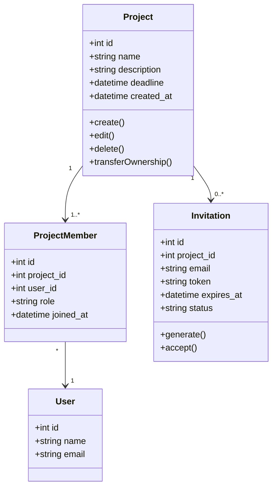

#### Sequence Diagram — Create Project & Invite Members

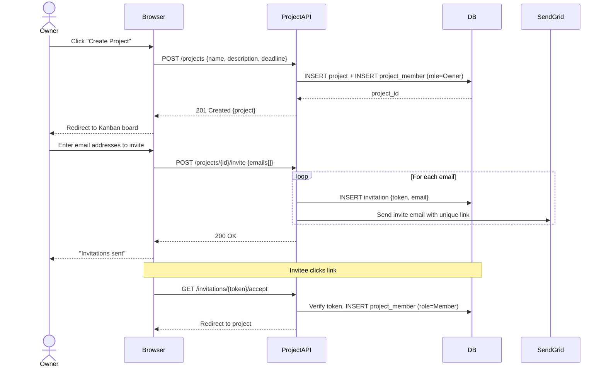

---

### 4.4 Kanban Board

**Priority:** High

#### Functional Requirements

| Req ID | Description | Priority |
|---|---|---|
| REQ-FR-013 | Display Kanban board with columns: To Do, In Progress, Review, Done | High |
| REQ-FR-014 | Allow add/edit/delete task cards with title, description, labels, deadline, assignee | High |
| REQ-FR-015 | Support drag-and-drop to move cards between columns | High |
| REQ-FR-016 | Auto-update task status when card is moved to a different column | High |
| REQ-FR-017 | Allow filtering tasks by assignee, label, or deadline | Medium |
| REQ-FR-018 | Allow searching tasks by title or description keyword | Medium |
| REQ-FR-019 | Allow Owner to customize column names | Low |

#### Conceptual Class Diagram

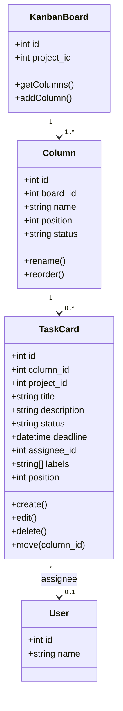

#### Sequence Diagram — Create Task & Move Task

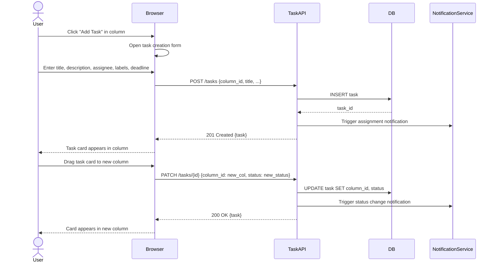

---

### 4.5 AI Task Decomposition

**Priority:** High

#### Functional Requirements

| Req ID | Description | Priority |
|---|---|---|
| REQ-FR-020 | Provide AI input panel for entering high-level task description | High |
| REQ-FR-021 | Send task description + team member profiles to LLM API | High |
| REQ-FR-022 | Display 3–5 AI-generated subtasks with title, description, estimated effort, suggested assignee | High |
| REQ-FR-023 | Allow user to accept, modify, or reject each subtask before adding to board | High |
| REQ-FR-024 | Display error + suggest manual creation if LLM API unavailable | Medium |

#### Conceptual Class Diagram

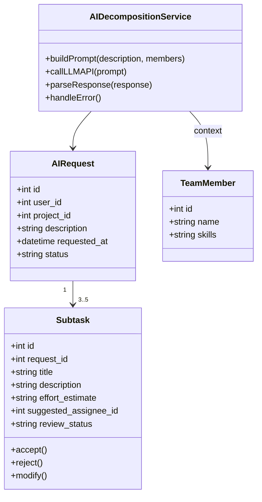

#### Sequence Diagram — AI Task Decomposition

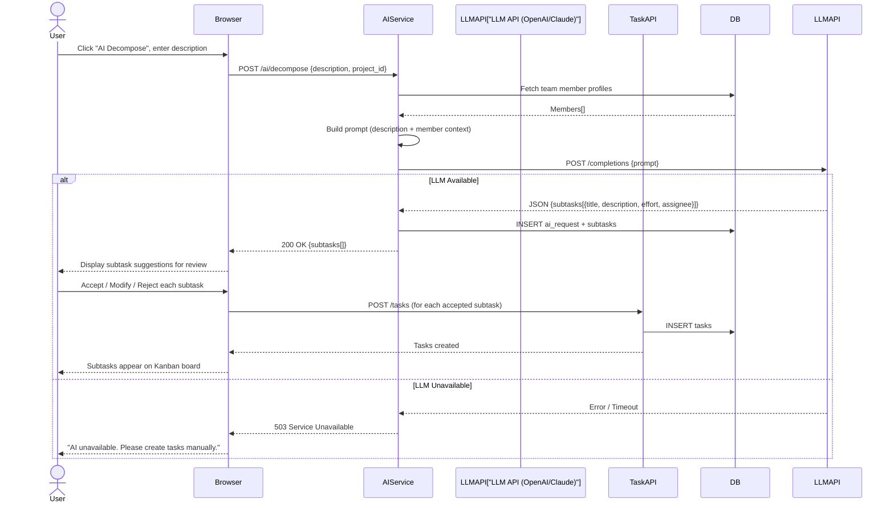

---

### 4.6 Notification System

**Priority:** High

#### Functional Requirements

| Req ID | Description | Priority |
|---|---|---|
| REQ-FR-025 | Send email notification to assignee when task is assigned | High |
| REQ-FR-026 | Send email + in-app reminder at 24h and 1h before task deadline | High |
| REQ-FR-027 | Send in-app notification when task status changes | Medium |
| REQ-FR-028 | Deliver in-app notifications in real-time via WebSocket | High |
| REQ-FR-029 | Allow users to view notification history in notification center | Medium |
| REQ-FR-030 | Allow users to mark notifications as read | Low |

#### Conceptual Class Diagram

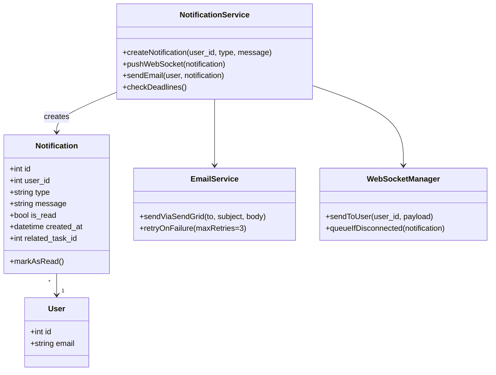

#### Sequence Diagram — Deadline Reminder Notification

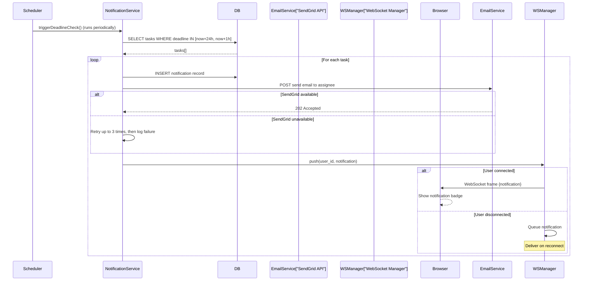

---

### 4.7 Data Analytics

**Priority:** Medium

#### Functional Requirements

| Req ID | Description | Priority |
|---|---|---|
| REQ-FR-031 | Display burndown chart: remaining tasks vs. time | Medium |
| REQ-FR-032 | Display bar chart: task completion rate by team member | Medium |
| REQ-FR-033 | Display pie chart: workload distribution across members | Medium |
| REQ-FR-034 | Display overall project progress as percentage | Medium |
| REQ-FR-035 | Update analytics in real-time as tasks are created/moved/completed | Low |

#### Conceptual Class Diagram

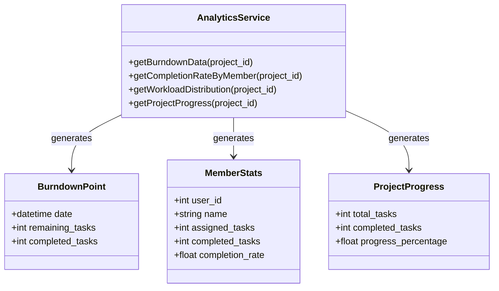

#### Sequence Diagram — View Analytics Dashboard

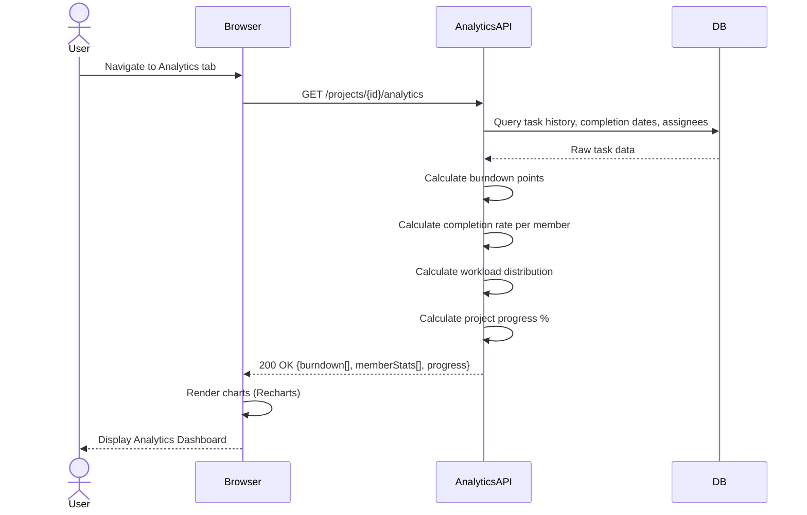

---

### 4.8 Dialog Maps

#### 4.8.1 Application Navigation Flow

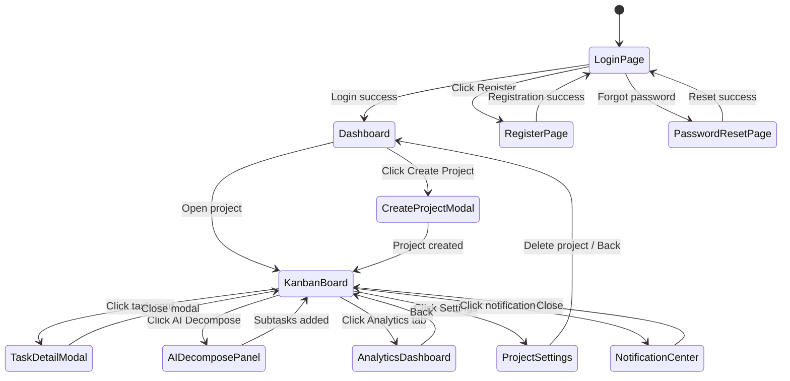

#### 4.8.2 Task Lifecycle State Machine

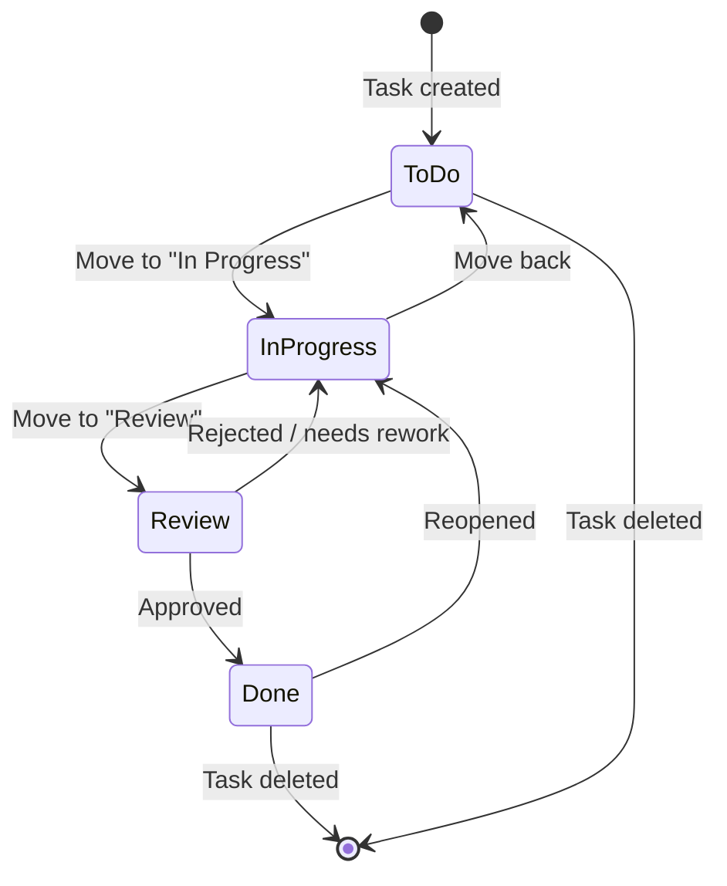

---

### 4.9 Activity Diagrams

#### 4.9.1 User Registration and Project Creation

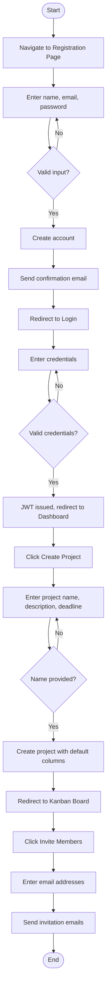

#### 4.9.2 AI Task Decomposition Workflow

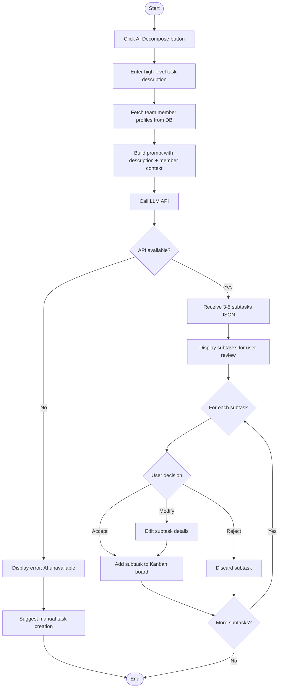

#### 4.9.3 Deadline Notification Workflow

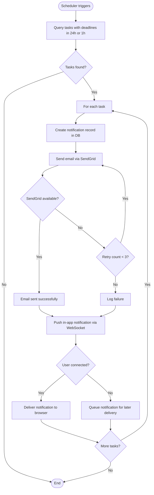

---

## 5. Non-Functional Requirements

### 5.1 Performance

| Req ID | Description | Priority |
|---|---|---|
| REQ-NF-001 | Kanban board loads within 3 seconds under normal network | High |
| REQ-NF-002 | Drag-and-drop responds within 500 ms | High |
| REQ-NF-003 | AI decomposition returns results within 10 seconds | Medium |
| REQ-NF-004 | Support ≥50 concurrent users without degradation | Medium |
| REQ-NF-005 | In-app notifications delivered within 2 seconds of trigger | Medium |

### 5.2 Safety

| Req ID | Description | Priority |
|---|---|---|
| REQ-NF-006 | No user data deleted without explicit confirmation | High |
| REQ-NF-007 | Maintain data integrity during concurrent task updates | High |

### 5.3 Security

| Req ID | Description | Priority |
|---|---|---|
| REQ-NF-008 | Passwords stored with bcrypt, min cost factor 10 | High |
| REQ-NF-009 | All client-server communication via HTTPS (TLS 1.2+) | High |
| REQ-NF-010 | JWT tokens max expiry 24 hours | High |
| REQ-NF-011 | Users can only access projects they are explicitly invited to | High |
| REQ-NF-012 | Validate and sanitize all user inputs (SQL injection, XSS) | High |

### 5.4 Software Quality Attributes

| Attribute | Requirement |
|---|---|
| Availability | 99% uptime during the semester |
| Reliability | Recover from crashes without data loss for committed transactions |
| Maintainability | PEP 8 (Python) and ESLint/Prettier (TypeScript) standards |
| Portability | Deployable via Docker on any Linux-based cloud platform |
| Usability | New user creates project + task within 5 minutes without docs |
| Testability | All API endpoints with unit tests, ≥70% code coverage |

### 5.5 Business Rules
- **BR-01:** Each project has exactly one Owner. Ownership is transferable.
- **BR-02:** A user can belong to max 10 active projects simultaneously.
- **BR-03:** Only Owner can delete a project; requires typed-name confirmation.
- **BR-04:** AI decomposition requires ≥2 team members to generate assignment suggestions.

---

## Appendix A: Glossary

| Term | Definition |
|---|---|
| Burndown Chart | Graphical remaining tasks vs. time |
| JWT | JSON Web Token — compact token for secure information transmission |
| Kanban Board | Visual workflow tool with columns (stages) and cards (tasks) |
| LLM | Large Language Model — AI for task decomposition |
| ORM | Object-Relational Mapping (SQLAlchemy) |
| Project Owner | Creator with full admin privileges |
| SendGrid | Cloud email delivery service |
| SPA | Single Page Application |
| Subtask | Smaller actionable task generated by AI module |
| Task Card | Visual element on Kanban representing a task |
| TLS | Transport Layer Security |
| WebSocket | Full-duplex communication protocol for real-time notifications |
| Workload Distribution | Task allocation per member, shown as pie chart |

---

## Appendix B: Analysis Models

### B.1 Overall Conceptual Class Diagram

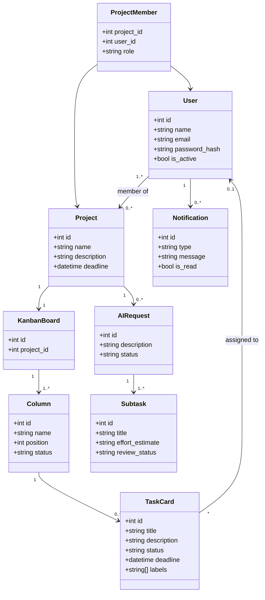

### B.2 Entity-Relationship Diagram

```mermaid
erDiagram
    USERS {
        int id PK
        string name
        string email UK
        string password_hash
        bool is_active
        datetime created_at
    }
    PROJECTS {
        int id PK
        string name
        string description
        datetime deadline
        datetime created_at
    }
    PROJECT_MEMBERS {
        int project_id FK
        int user_id FK
        string role
        datetime joined_at
    }
    KANBAN_BOARDS {
        int id PK
        int project_id FK
    }
    COLUMNS {
        int id PK
        int board_id FK
        string name
        int position
        string status
    }
    TASKS {
        int id PK
        int column_id FK
        int project_id FK
        int assignee_id FK
        string title
        string description
        string status
        datetime deadline
        string labels
        int position
        datetime created_at
        datetime updated_at
    }
    NOTIFICATIONS {
        int id PK
        int user_id FK
        int task_id FK
        string type
        string message
        bool is_read
        datetime created_at
    }
    AI_REQUESTS {
        int id PK
        int user_id FK
        int project_id FK
        string description
        string status
        datetime created_at
    }
    SUBTASKS {
        int id PK
        int request_id FK
        int task_id FK
        string title
        string description
        string effort_estimate
        int suggested_assignee_id FK
        string review_status
    }
    AUTH_TOKENS {
        int id PK
        int user_id FK
        string token
        datetime expires_at
        bool is_revoked
    }
    PASSWORD_RESET_TOKENS {
        int id PK
        int user_id FK
        string token
        datetime expires_at
        bool is_used
    }
    INVITATIONS {
        int id PK
        int project_id FK
        string email
        string token
        string status
        datetime expires_at
    }

    USERS ||--o{ PROJECT_MEMBERS : "belongs to"
    PROJECTS ||--o{ PROJECT_MEMBERS : "has"
    PROJECTS ||--|| KANBAN_BOARDS : "has"
    KANBAN_BOARDS ||--o{ COLUMNS : "has"
    COLUMNS ||--o{ TASKS : "contains"
    USERS ||--o{ TASKS : "assigned to"
    USERS ||--o{ NOTIFICATIONS : "receives"
    TASKS ||--o{ NOTIFICATIONS : "triggers"
    USERS ||--o{ AI_REQUESTS : "creates"
    PROJECTS ||--o{ AI_REQUESTS : "has"
    AI_REQUESTS ||--o{ SUBTASKS : "generates"
    USERS ||--o{ AUTH_TOKENS : "has"
    USERS ||--o{ PASSWORD_RESET_TOKENS : "has"
    PROJECTS ||--o{ INVITATIONS : "has"
```

---

## Appendix C: To Be Determined

| TBD # | Description | Target |
|---|---|---|
| TBD-001 | Final LLM provider selection (OpenAI vs. Claude) based on cost/performance | Week 6 |
| TBD-002 | Prompt engineering strategy for optimal AI decomposition results | Week 6 |
| TBD-003 | Email notification templates and content wording | Week 7 |
| TBD-004 | Max file attachment size for task comments (if file upload supported) | Week 7 |
| TBD-005 | Error handling and retry strategy for LLM API failures | Week 6 |
